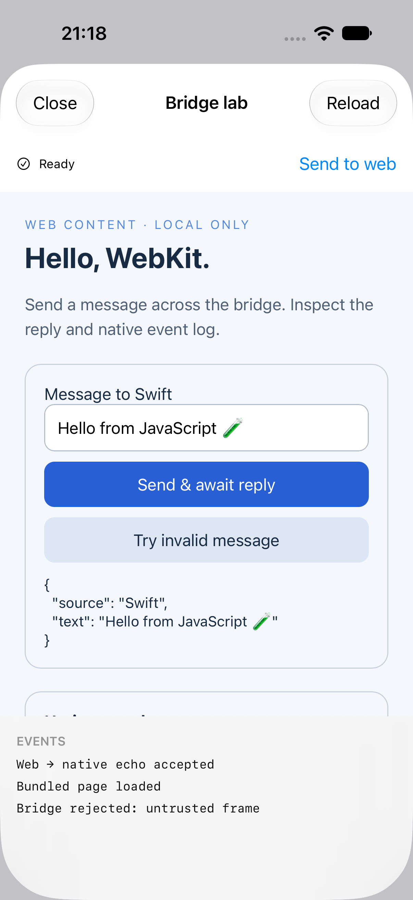
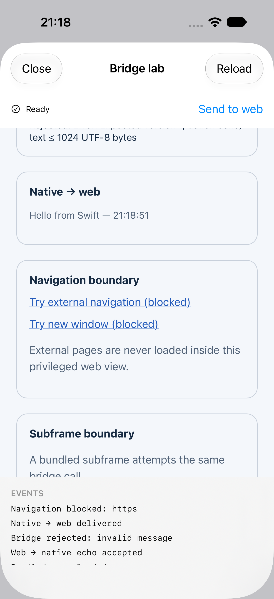

# WKWebView Lab

A focused iOS demo of native–web messaging, navigation boundaries, and explicit WebKit teardown. Built with SwiftUI and WKWebView, using bundled HTML and no third-party dependencies.

<p> </p>

## Run

Open `WKWebViewLab.xcodeproj`, choose the **WKWebViewLab** scheme and an iOS simulator, then Run. Deployment target: iOS 17+. The project was authored with Xcode 27. For a physical device, select your own signing team.

## Try it

1. Open the lab and send an echo message. JavaScript awaits a structured reply from Swift.
2. Send quotes, emoji, or JavaScript-looking text. It should remain plain data.
3. Try an invalid message: the promise rejects and the native log records the reason.
4. Tap **Send to web**: Swift passes an argument to JavaScript, which updates textContent.
5. Try external navigation or a new window: both are blocked.
6. The bundled subframe attempts a bridge call and should be rejected.
7. Reload, close, and reopen. The debug console prints `WebSession released` when the session deallocates.

## Engineering decisions

- **Request/reply:** `WKScriptMessageHandlerWithReply` avoids manually maintaining callback IDs and a global JavaScript callback registry.
- **Explicit trust boundary:** only the exact bundled main document can call the bridge. The frame fixture may load, but cannot use native capabilities. External navigation is denied, including new windows.
- **Narrow schema:** version 1 + `echo` + a text value limited to 1,024 UTF-8 bytes. Unsupported actions and malformed payloads fail closed.
- **Data, not source:** native-to-web values use `callAsyncJavaScript` arguments. Replies use structured objects. Web output uses `textContent`.
- **Lifecycle:** the handler callback captures the session weakly; teardown stops loading, removes the handler and clears delegates. The demo uses a nonpersistent data store.
- **Recovery:** navigation failures and web-process termination expose a reload action. Navigation cancellation is not presented as a load failure.

The page uses the `.page` content world because its own JavaScript calls the bridge. This is appropriate only for this controlled bundled content; it is not a template for granting arbitrary remote pages native privileges. The small echo operation does not expose files, credentials, or device APIs.

## Tests

```sh
DEVELOPER_DIR=/Applications/Xcode.app/Contents/Developer xcrun swift test
```

The Foundation-only `LabCore` package tests document/frame authorization, schema rejection, byte limits, and preservation of potentially hostile text. The app compiles the same policy source directly. These tests do not substitute for WebKit integration testing.

See [validation](docs/VALIDATION.md) for build results and the manual test checklist, and [case study](docs/CASE-STUDY.md) for the problem and tradeoffs.

## Scope

This is an independent technical demonstration, not a production browser or an extraction from an employer's application. No proprietary source code or customer data is included. It intentionally omits authentication, cookie synchronization, downloads, arbitrary browsing, and production telemetry.

## References

- [Apple: WKScriptMessageHandlerWithReply](https://developer.apple.com/documentation/webkit/wkscriptmessagehandlerwithreply)
- [Apple: callAsyncJavaScript](https://developer.apple.com/documentation/webkit/wkwebview/callasyncjavascript(_:arguments:in:contentworld:))
